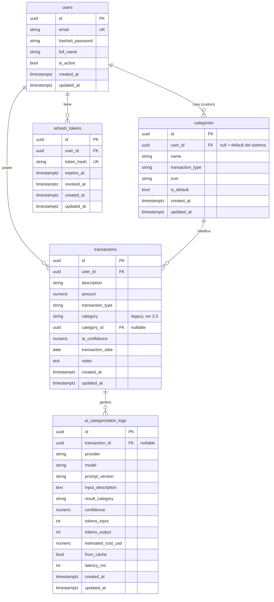

# Estructura de Base de Datos — FinFlowIA

**Motor:** PostgreSQL 16. **Convenciones:** PK `UUID` (`uuid.uuid4`), `created_at`/`updated_at` en todas las tablas (`BaseEntity`), nombres de tabla en snake_case plural. Ver [RFC.md](../../RFC.md) para el contexto de producto y roadmap por fases.

Este documento cubre el esquema en tres capas, alineadas a las fases del RFC:

- **Fase 1 (MVP)** y **Fase 2 (near-term)** — implementadas como modelos SQLAlchemy + migraciones Alembic (`0001`, `0002`).
- **Fase 3 (escalable)** — especificada aquí para referencia futura, **no implementada todavía**. Construirla antes de tener la necesidad real (multi-tenant, presupuestos) contradice el punto 11.1 del RFC ("qué evitar: sobreingeniería"); el objetivo de documentarla ahora es que agregarla más adelante sea un cambio aditivo y no un rediseño.

---

## 1. Diagrama entidad-relación (estado actual, Fase 1+2)



---

## 2. Fase 1 (MVP) — `migrations/versions/0001_initial_schema.py`

Formaliza lo que ya existía como modelos sin migración generada.

### `users`
| Columna | Tipo | Notas |
|---|---|---|
| id | UUID PK | |
| email | VARCHAR(255) | UNIQUE, INDEX |
| hashed_password | VARCHAR(255) | bcrypt, nunca en texto plano ni en logs |
| full_name | VARCHAR(255) | |
| is_active | BOOLEAN | default true — permite desactivar sin borrar (preserva integridad referencial de sus transacciones) |

### `transactions`
| Columna | Tipo | Notas |
|---|---|---|
| id | UUID PK | |
| user_id | UUID FK → users.id | `ON DELETE CASCADE`, INDEX |
| description | VARCHAR(500) | |
| amount | NUMERIC(12,2) | `CHECK (amount > 0)` — el signo lo da `transaction_type`, no un monto negativo |
| transaction_type | VARCHAR(20) | `CHECK IN ('income','expense')` |
| category | VARCHAR(50) | legacy, ver §3.3 |
| ai_confidence | NUMERIC(4,3) | null si la categoría fue manual |
| transaction_date | DATE | INDEX — fecha del negocio, no `created_at` |
| notes | TEXT | |

**Índice compuesto** `(user_id, transaction_date)`: todas las consultas reales (dashboard, reportes, listado paginado) filtran por usuario y rango de fechas simultáneamente — es el patrón de acceso dominante, así que el índice compuesto evita que Postgres tenga que combinar dos índices simples.

---

## 3. Fase 2 (near-term) — `migrations/versions/0002_categories_refresh_tokens_ai_logs.py`

### 3.1 `categories`

Reemplaza el enum cerrado `CategoryType` por una tabla, habilitando "categorías personalizadas por usuario" (RFC Fase 2, semana 10-11) sin tocar el resto de la app todavía.

| Columna | Tipo | Notas |
|---|---|---|
| id | UUID PK | |
| user_id | UUID FK → users.id, NULLABLE | `NULL` = categoría del sistema (visible para todos); no-null = categoría propia del usuario. Mismo mecanismo de lookup para ambos casos, sin ramas especiales en el código que las consulte |
| name | VARCHAR(50) | |
| transaction_type | VARCHAR(20) | `CHECK IN ('income','expense')` — una categoría es de ingreso o gasto, no ambas |
| icon | VARCHAR(50) | opcional, para `CategoryBadge.tsx` en el frontend |
| is_default | BOOLEAN | marca las 14 filas sembradas en la migración (una por cada valor de `CategoryType`, con `other`/`uncategorized` duplicados por tipo porque el código actual los usa para ambos) |

`UNIQUE(user_id, name, transaction_type)` evita duplicados por usuario sin bloquear que dos usuarios distintos tengan una categoría con el mismo nombre.

### 3.2 `refresh_tokens`

El RFC (§5.6) pide JWT de corta duración + refresh tokens; hoy no existe dónde persistirlos.

| Columna | Tipo | Notas |
|---|---|---|
| id | UUID PK | |
| user_id | UUID FK → users.id | `ON DELETE CASCADE` |
| token_hash | VARCHAR(255) | UNIQUE — se guarda el hash (sha256), nunca el token crudo: un dump de la base no debe entregar sesiones válidas |
| expires_at | TIMESTAMPTZ | |
| revoked_at | TIMESTAMPTZ, NULLABLE | revocar es un timestamp, no un DELETE, para poder detectar y loguear el reuso de un token ya revocado (señal típica de robo de token) |

### 3.3 `transactions.category_id` (columna agregada, no migración de datos)

Se agrega `category_id UUID FK → categories.id (ON DELETE SET NULL)`, nullable, **en paralelo** a la columna `category` string existente. Es un cambio aditivo a propósito: la migración no reescribe filas existentes ni obliga a tocar `schemas.py` / `service.py` / `categorizer.py` en este cambio. Cablear la app para que lea/escriba `category_id` en vez del string es un paso de código separado (fuera del alcance de "estructurar la base de datos"), con este plan de salida:

1. Backfill: `UPDATE transactions SET category_id = (SELECT id FROM categories WHERE name = transactions.category AND transaction_type = transactions.transaction_type AND is_default) WHERE category_id IS NULL`.
2. Cambiar `TransactionResponse`/`CreateTransactionRequest` para exponer `category_id` (y opcionalmente el nombre vía join) en lugar de un string libre.
3. Una vez migrado el 100% del tráfico, eliminar la columna `category` en una migración posterior.

### 3.4 `ai_categorization_logs`

Las métricas de Prometheus (`llm_tokens_used`, `llm_cost_usd`, `llm_cache_hits` en `infrastructure/observability/metrics.py`) dan agregados, pero no detalle histórico consultable ni el dataset para evaluación offline de prompts (RFC §8.5, dataset de ~200 casos). Esta tabla persiste cada llamada real al LLM.

| Columna | Tipo | Notas |
|---|---|---|
| id | UUID PK | |
| transaction_id | UUID FK → transactions.id, NULLABLE | `ON DELETE SET NULL` — nullable porque una corrida de evaluación offline puede loguear sin transacción real asociada |
| provider / model / prompt_version | VARCHAR | ata a qué combinación corresponde el resultado, clave para comparar versiones de prompt |
| input_description | TEXT | descripción normalizada enviada al LLM (misma que se usa como clave de caché) |
| result_category / confidence | VARCHAR / NUMERIC(4,3) | |
| tokens_input / tokens_output / estimated_cost_usd | INT / INT / NUMERIC(10,6) | espejo de las métricas Prometheus, pero persistente |
| from_cache | BOOLEAN | |
| latency_ms | INT, NULLABLE | |

---

## 4. Fase 3 (escalable) — diseño, no implementada

Corresponde a RFC semanas 15-24. Se especifica para que agregarla no requiera re-tocar las tablas de Fase 1/2, pero **no se generan modelos ni migraciones todavía** — no hay necesidad real hasta tener multi-tenant o presupuestos en el roadmap activo.

### 4.1 Multi-tenancy — resuelve ADR-004 del RFC

El RFC deja pendiente "row-level security vs. schemas separados". Recomendación: **row-level security lógica vía columna `business_id`**, no schemas separados por negocio. Con un solo desarrollador y bajo presupuesto, N schemas de Postgres significa N migraciones a correr por deploy y sin beneficio real de aislamiento a esta escala; una columna `business_id` indexada en cada tabla de negocio, filtrada explícitamente (o con `RLS` nativo de Postgres si hiciera falta blindarlo) logra el mismo aislamiento lógico con una sola migración por cambio de esquema.

```
businesses
├── id UUID PK
├── name VARCHAR(255)
├── currency VARCHAR(3) default 'ARS'   -- consistente con Money value object
├── created_at / updated_at

users
├── ...columnas actuales...
├── business_id UUID FK → businesses.id, NULLABLE, INDEX   -- nullable en el MVP; NOT NULL una vez migrados los usuarios existentes
├── role VARCHAR(20)   -- 'owner' | 'member', evita una tabla de roles para un caso de uso tan simple

transactions / categories
├── business_id UUID FK → businesses.id, INDEX   -- denormalizado desde user, para no tener que joinear con users en cada query filtrada por tenant
```

### 4.2 `budgets` (RFC: "alertas de presupuesto")

```
budgets
├── id UUID PK
├── user_id UUID FK → users.id, INDEX
├── category_id UUID FK → categories.id, NULLABLE   -- NULL = presupuesto general, no por categoría
├── period_type VARCHAR(10)   -- 'monthly' por ahora; no vale la pena un enum más rico sin un segundo caso de uso real
├── amount_limit NUMERIC(12,2)
├── period_start DATE
├── UNIQUE(user_id, category_id, period_start)
```

### 4.3 `notifications` (RFC: "notificaciones email, alertas de presupuesto")

```
notifications
├── id UUID PK
├── user_id UUID FK → users.id, INDEX
├── type VARCHAR(30)   -- 'budget_alert' | 'weekly_summary' | ...
├── payload JSONB       -- estructura libre por tipo; evita una tabla/columna por cada tipo de notificación
├── read_at TIMESTAMPTZ, NULLABLE
├── created_at
```

### 4.4 `api_keys` (RFC: "API pública con rate limiting y API keys")

```
api_keys
├── id UUID PK
├── business_id UUID FK → businesses.id, INDEX
├── key_hash VARCHAR(255) UNIQUE   -- mismo criterio que refresh_tokens: nunca la clave en texto plano
├── name VARCHAR(100)
├── last_used_at TIMESTAMPTZ, NULLABLE
├── revoked_at TIMESTAMPTZ, NULLABLE
├── created_at
```

### 4.5 `reports` — resuelve ADR-003 del RFC

El RFC deja pendiente "almacenamiento de PDFs en DB vs. object storage". Resolución: **metadata en Postgres, archivo en object storage** (Cloudflare R2 / S3, ya recomendado en RFC §11.2 — "no implementar almacenamiento propio"). Guardar binarios de PDFs en Postgres infla el tamaño de la DB, complica backups y no gana nada frente a un bucket con URL firmada.

```
reports
├── id UUID PK
├── user_id UUID FK → users.id, INDEX
├── report_type VARCHAR(20)   -- summary | by_category | monthly, espeja ReportType en schemas.py
├── format VARCHAR(10)        -- pdf | csv
├── start_date / end_date DATE
├── file_url VARCHAR(500)     -- URL en object storage, no el archivo en sí
├── created_at
```

---

## 5. Qué se decidió no modelar (y por qué)

Siguiendo el punto 11 del RFC ("qué evitar"):

- **Sin tabla de auditoría genérica** para todas las entidades — `created_at`/`updated_at` en `BaseEntity` alcanza para el MVP; un audit log completo (quién cambió qué campo) no tiene un caso de uso real todavía.
- **Sin particionamiento de `transactions`** por fecha — el RFC lo menciona como optimización de Fase 3 (§21-22), pero a los volúmenes de un solo negocio pequeño un índice compuesto alcanza; particionar antes de tener el problema es trabajo desperdiciado.
- **Sin tabla de roles/permisos genérica** — un `role` VARCHAR de dos valores (`owner`/`member`) en `users` cubre el caso de Fase 3; una tabla `roles`/`permissions` normalizada es sobreingeniería mientras solo existan dos roles.

---

## 6. Cómo aplicar

```bash
cd FinFlowIA-Backend
alembic upgrade head          # corre 0001 y 0002 contra DATABASE_URL
python scripts/seed_db.py     # datos de ejemplo (usa create_all, no depende de Alembic)
```

Las migraciones fueron escritas a mano (sin `alembic revision --autogenerate`, porque no hay una DB corriendo en este entorno para compararlas). Antes de aplicarlas contra un ambiente real, correr `alembic upgrade head --sql` para revisar el SQL generado.
